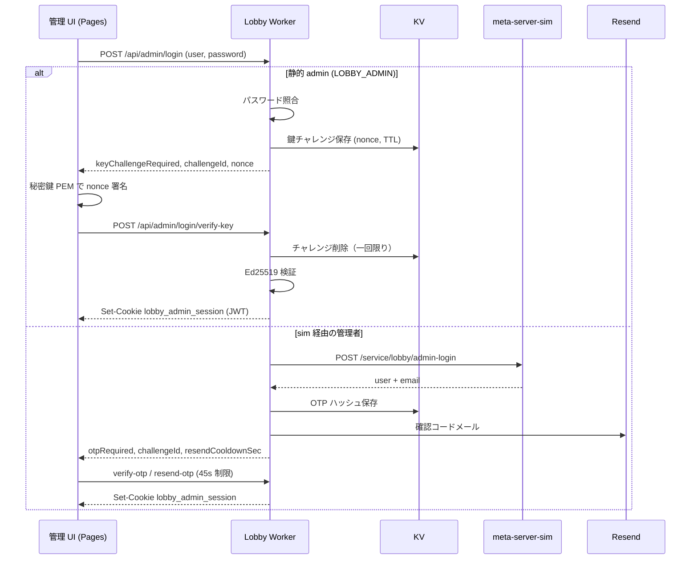

# 管理画面ログイン — 第2要素（admin 鍵認証 / その他メール OTP）

## 調査：方式比較

| 観点 | 案 A: Ed25519 チャレンジ署名 | 案 B: WebAuthn（パスキー） |
|------|------------------------------|----------------------------|
| 脅威モデル | 秘密鍵ファイルの取り扱いは利用者責任。フィッシングでパスワード+盗んだ鍵が同時に漏れるリスクは残る | ドメイン束縛・フィッシング耐性が高い |
| 復旧（鍵ロスト） | サーバー側の**公開鍵だけ**を SSH 等で差し替え。メールへの自動フォールバックは設けない | デバイス紛失時は別デバイス登録が必要。Worker 運用と「藤原さんが公開鍵を登録」の手順と相性が悪い |
| ステージング検証 | テスト用 PEM をホスト上 600 で保持し、ブラウザからファイル選択で署名可能 | ヘッドレス・CI で再現しづらい |
| Cloudflare Worker | Web Crypto の Ed25519 verify で実装可能 | WebAuthn 検証は可能だが ceremony・ origin RP ID・複数クレデンシャル管理が重い |
| 既存フローとの接続 | パスワード成功後に nonce を返し、クライアントが署名して POST → 既存 JWT クッキー発行と同じ | 同様に 2 段階目として置けるが UI/登録フローが大きい |

## 採用方式

**案 A（Ed25519 チャレンジ署名）** を採用する。

理由: 公開鍵の登録・入れ替えをインフラ手順（SSH + 環境変数）に閉じられること、メール OTP への弱い復旧経路を作らない要件、ステージングでファイルベースの鍵を扱えること、Worker 上でシンプルに replay 防止（短命 nonce + KV 一回限り）を実装できること。

WebAuthn は将来の強化候補として残すが、本タスクの運用制約には Ed25519 の方が無理がない。

## ログインフローへの組み込み

全体は **パスワード（第1要素）の成功後に第2要素**（既存の `POST /api/admin/login` → 第2要素用 API → セッション）。

- **セッション**: 従来どおり `lobby_admin_session` JWT（`LOBBY_ADMIN_SESSION_SECRET`）。第2要素成功時のみ `set-cookie`。
- **監査**: D1 `super_admin_login_events`（静的 admin のみ。sim 管理者の OTP は現状テーブル名は super だが password_ok / otp_failed / session_ok を記録）。

## admin（スーパー管理者）— 鍵認証

| 項目 | 値 |
|------|-----|
| 環境変数 | `ADMIN_ED25519_PUBLIC_KEY` — Ed25519 公開鍵 32 バイトの base64（**秘密鍵は置かない**） |
| チャレンジ TTL | 300 秒（KV） |
| 署名対象 | UTF-8 文字列 `lobby-admin-key-v1:{challengeId}:{nonce}`（nonce は base64url 32 バイト） |
| 試行上限 | 5 回 / チャレンジ（超過で `key_locked`） |
| リプレイ | 検証成功時に KV エントリ削除。期限切れ・二重送信は拒否 |

### 公開鍵の登録・入れ替え

1. 利用者がローカルで `ssh-keygen -t ed25519` 等により鍵ペアを生成（**秘密鍵はコミットしない**）。
2. 公開鍵 32 バイト（raw）を base64 にし、Worker の `ADMIN_ED25519_PUBLIC_KEY` に設定（GitHub Actions secret / `wrangler secret` / ステージング `.dev.vars`）。
3. デプロイ後、パスワード + 新秘密鍵でログイン確認。

### 鍵紛失時の復旧（メールフォールバックなし）

1. サーバー管理者が SSH でホストまたは秘密管理ストアに接続。
2. 新しい鍵ペアを生成し、**公開鍵のみ**を `ADMIN_ED25519_PUBLIC_KEY` に反映して Worker を再デプロイ。
3. 藤原さんが手元の新秘密鍵でログイン。

## admin 以外の管理者 — Resend メール OTP

| 項目 | 値 |
|------|-----|
| 有効化 | Worker に `RESEND_API_KEY`（+ `RESEND_FROM_EMAIL`） |
| 宛先 | sim が返す `user.email`（未登録・`@mmh.local`・不正形式は **503** `otp_mail_no_recipient`） |
| OTP | 6 桁、TTL 600 秒、試行 5 回（既存と同じ） |
| 再送信 | `POST /api/admin/login/resend-otp`。管理者 `sub` ごとに直近送信から **45 秒** は **429** `otp_resend_cooldown` + `retryAfterSec` |
| 再送信時 | 新コード発行、旧 `challengeId` は KV から削除 |

SMS（`ADMIN_PHONE`）は admin 鍵認証導入後の第2要素としては使わない（非 admin はメールのみ）。

## 本番反映時（藤原さん作業）

1. 本番用 Ed25519 鍵ペアを**ローカルで**生成。
2. 公開鍵（base64 raw 32B）だけを本番 Worker の `ADMIN_ED25519_PUBLIC_KEY` に登録。
3. `RESEND_*` を維持し、非 admin 管理者のメール OTP を有効化。
4. `ADMIN_PHONE` / `ADMIN_EMAIL` を admin 向け OTP 用に設定しない（admin は鍵のみ）。
5. Worker + Pages をデプロイし、admin でパスワード→署名、別管理者でメール OTP を確認。

## 鍵の発行（管理画面・admin のみ）

- WebCrypto で鍵ペア生成 → 公開鍵のみ `POST /api/admin/admin-keys`。
- 既に有効鍵がある場合は `POST /api/admin/admin-keys/reauth-challenge` の nonce を既存秘密鍵で署名してから登録。
- 登録ごとに Resend で `developer@mmh-virtual.jp` へ通知（鍵名・FP・IP・UA・有効本数）。秘密鍵は含めない。
- 初回 1 本目は **SSH/CLI**（`scripts/lobby-admin-ed25519-bootstrap.md`）。

## 公開鍵 0 件の警告メール

- 条件: D1 有効鍵 0 かつ `ADMIN_ED25519_PUBLIC_KEY` 未設定。
- 送信契機: Worker `scheduled`（起動相当）と、admin がパスワード OK 後に第2要素へ進めないとき。
- レート: KV で **1 時間 1 通**。
- 宛先: `developer@mmh-virtual.jp`。本文に復旧手順（SSH/CLI）。

## ステージング

- テスト用鍵ペアを生成。公開鍵のみ Worker ステージング設定に登録。
- 秘密鍵はステージングホスト上 `nagi` のみ読めるパス・モード `600`（パスと公開鍵 SHA256 先頭を運用メモに記録。秘密鍵本文は記録しない）。