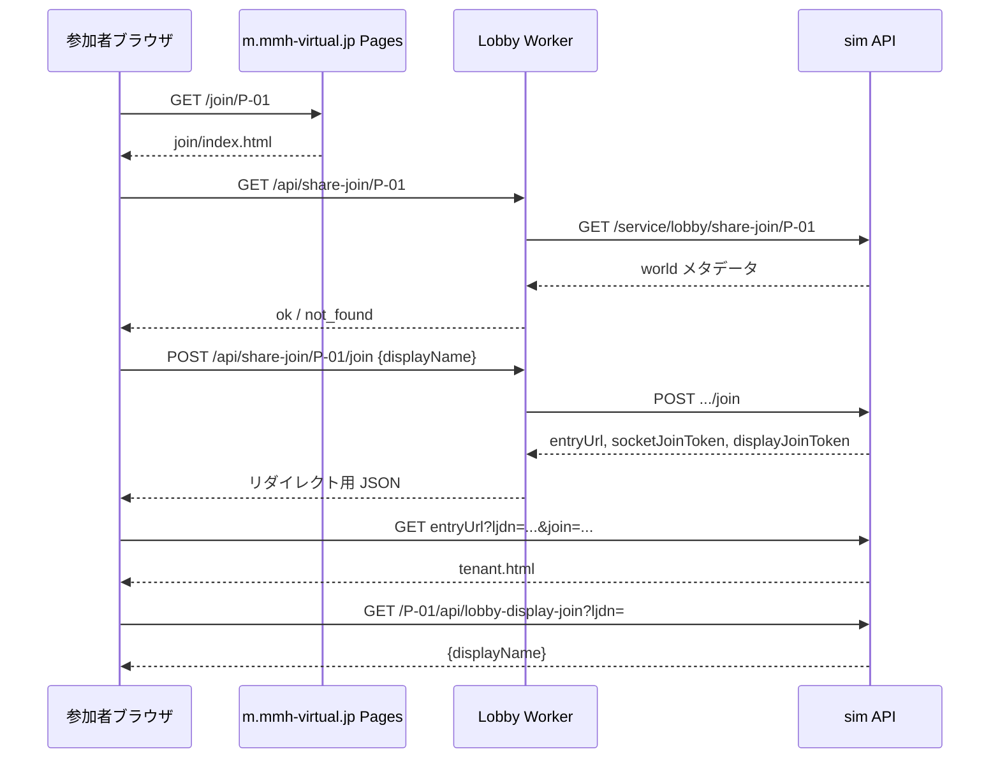

# 共有 URL によるテナント参加（`/join/<tenantId>`）

## 解釈（確定）

共有 URL は **m.mmh-virtual.jp 上の参加専用ページ** とし、メタバース一覧・ログインを経由しない。

| 項目 | 内容 |
|------|------|
| URL 形 | `https://m.mmh-virtual.jp/join/<tenantId>`（例: `/join/meta-server`, `/join/P-01`） |
| トークン・発行・保存 | **なし**（tenantId をパスに載せるだけ。期限なし） |
| 誰が「発行」するか | **誰でも**（未ログインゲスト含む）。発行 API は URL を返すだけ |
| コピー UI | **メタバース一覧**の各カード右上「⋯」ドロップダウンに **「共有URLをコピー」**（お気に入り項目の直上）。ログイン不要。`navigator.clipboard.writeText`、失敗時は `textarea` + `execCommand('copy')`。完了は既存トースト（約 2.4 秒） |
| 参加画面 | 表示名入力欄と「参加」ボタンのみ |
| 表示名の受け渡し | **URL に生の表示名を載せない**。短期 `ljdn` トークン（`lib/lobby-display-name-join-token.js`）でテナント側が検証し `localStorage.username` に反映 |
| テナント別 OFF スイッチ | **実装しない**（`tenant.json` フラグ等は設けない） |

## アーキテクチャ

| 層 | 責務 |
|----|------|
| Pages `/join/*` | 単一 HTML（表示名のみ） |
| Worker `/api/share-join/:tenantId` | 解決・参加（sim 委譲） |
| sim `/api/share-join-url/:tenantId` | 共有 URL 文字列の返却（存在・有効性確認） |
| sim `/service/lobby/share-join/*` | Worker 用の解決・参加（Bearer） |
| sim `/:tenant/api/lobby-display-join` | `ljdn` 検証 |

## 検証（tenantId）

1. `lib/tenant-id.js` の ID 規則（予約語 `join` 等は不可）
2. `getTenant(tenantId)` が存在すること（無効・未登録テナントは参加不可）
3. `lobby-catalog.json` に対応エントリがあり、`entryUrl` がポリシー上許可されていること
4. メンテナンス（カタログ `maintenance` / `lobbyStatus=maint`、sim `LOBBY_MAINTENANCE`）時は 503
5. カタログ `audience` が `signed` / `admin` のみの場合、未ログイン共有参加では **not_found** 扱い（従来ロビーと同様）

## API 仕様

### `GET /api/share-join-url/:tenantId`（sim・公開）

- 認証: 不要
- レート制限: `createShareJoinRateLimit()`（1 分あたり上限）
- 200: `{ ok: true, tenantId, shareUrl, displayName, worldName }`
- 404: `{ error: 'not_found' }`（ID 不正・テナントなし・カタログなし・ audience 不可）

`shareUrl` は `resolveLobbyPublicUrl()` 基準の `join/<tenantId>`。

### Worker `GET /api/share-join/:tenantId`

sim の service 経由で同内容を返す（`worldName`, `status` 等）。

### Worker `POST /api/share-join/:tenantId/join`

Body: `{ "displayName": "..." }`

- 表示名: 最大 64 文字、`^[\p{L}\p{N}_\- ]+$`（XSS 回避はエスケープ表示のみ。HTML へ生埋め込みしない）
- Jev/Gemini モデレーション（既存 `moderateLobbyDisplayName` / sim 側ポリシー）
- 200: `{ ok, entryUrl, socketJoinToken?, displayJoinToken }`
- 422: `display_name_rejected`
- 503: `maintenance`

参加先遷移時: `entryUrl?ljdn=<displayJoinToken>` と、必要時 `&join=<socketJoinToken>`。

### `GET /:tenantId/api/lobby-display-join?ljdn=`

- 有効な `ljdn` のみ `{ ok: true, displayName }`
- 失効・改ざん: 400

## レート制限

| 対象 | 実装 |
|------|------|
| `GET /api/share-join-url/:tenantId` | sim Express rate limit |
| `POST /service/lobby/share-join/:tenantId/join` | sim Express rate limit（IP キー） |
| 参加ページの POST | Worker → sim へ集約（上記に含む） |

`HTTP_RATE_LIMIT_DISABLE=1` でテスト時無効化可（既存と同様）。

## 表示名検証

ロビー参加と同じパイプライン（Worker `display-name-moderator.js`、sim `moderateDisplayNameForJoin`）。

## デプロイ

| 対象 | 方法 |
|------|------|
| sim | 本リポ `main` マージ後、ステージング `metasim-staging-server` → 本番 `metasim-server`（`git pull --ff-only`, `npm ci`, `build`, restart） |
| m.mmh-virtual.jp | `.github/workflows/deploy-metaverse-lobby.yml` または `scripts/lobby-provision-cloudflare.sh`（**デプロイ先変更なし**） |

環境変数（新規・任意）:

| 変数 | 用途 |
|------|------|
| `LOBBY_DISPLAY_JOIN_SECRET` | `ljdn` 署名（未設定時は `SOCKET_AUTH_SECRET` を流用。本番は専用値推奨） |

## 検証項目（E2E / 手動）

| ID | 内容 |
|----|------|
| SJ-01 | `GET /api/share-join-url/P-01` が shareUrl を返す |
| SJ-02 | ゲストがロビーから共有 URL をコピーできる |
| SJ-03 | `/join/<有効 tenantId>` → 表示名 → 参加 → テナント内で同名表示（**URL に表示名なし**） |
| SJ-04 | 存在しない tenantId → 「見つかりません」 |
| SJ-05 | メンテ中テナント → 参加不可 |
| SJ-06 | P-01〜P-03・通常ロビー導線の回帰 |

本番 smoke: `https://m.mmh-virtual.jp/join/meta-server`（`meta-server` 未反映時は `P-01` で代替し報告）。

## ロールバック

- sim: 直前コミットへ `git revert` + 再起動
- Worker/Pages: 直前デプロイへ Cloudflare ロールバック、または Actions 再実行